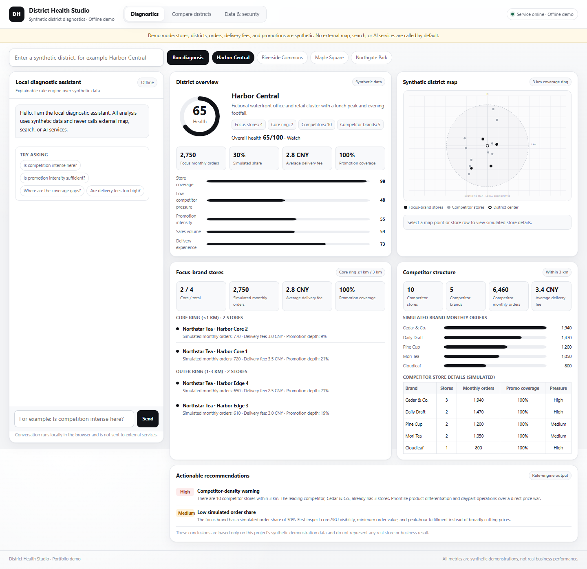
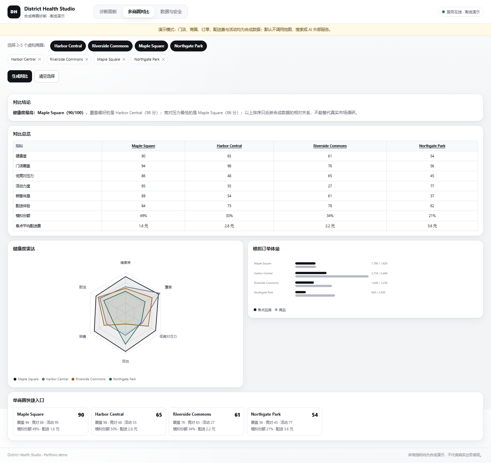
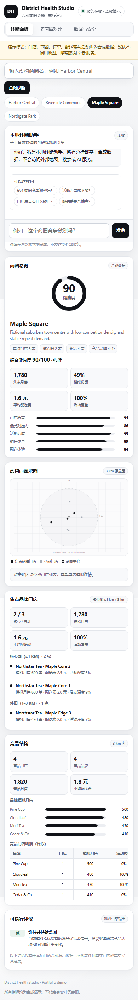

**Live Demo:** https://trade-area-intelligence-bot.pages.dev/

# District Health Studio · Synthetic District Health Workbench (Public Portfolio Edition)

A portfolio-ready district diagnostics demo built on synthetic store data. It covers single-district diagnosis, multi-district comparison, health-score decomposition, competitor pressure, promotion intensity, interactive SVG maps, and structured diagnostic chat.

> **Data notice:** The project ships with 4 fictional districts and 42 fictional stores. Every store name, address, order count, delivery fee, promotion, health score, and ranking is synthetic. Nothing represents a real brand, store, or operating result.

> **Public-edition boundary:** This directory is an independently rebuilt portfolio copy. It contains none of the original project's source, real business data, runtime logs, local configuration, or Git history. The default demo uses a local SVG map and a deterministic rule engine instead of live map, search, or AI dependencies.

## Live Demo and Deployment

The public demo runs at **https://trade-area-intelligence-bot.pages.dev/**. It reuses the same static front end, analysis engine, and interaction flow as the local build. Four read-only Cloudflare Pages Functions replace the local Python API routes:

- `/api/health` returns demo status and version metadata.
- `/api/config` always reports `liveAIEnabled: false`.
- `/api/districts` returns the 4 fictional districts and 42 synthetic stores.
- `/api/chat` returns `409 live_disabled`; chat is handled by the in-browser rule engine.

The Pages build publishes only `index.html`, `css/`, `js/`, `data/`, `assets/`, `examples/`, `_headers`, and `functions/`. It excludes the Python server, tests, tools, scripts, documentation sources, environment files, runtime state, and Git history.

Rebuild and redeploy with:

```powershell
node tools\build_pages.mjs
npx wrangler pages deploy dist --project-name trade-area-intelligence-bot --branch main
```

Cloudflare credentials are not stored in this repository or in browser code. The current project uses direct Wrangler uploads; automatic GitHub-to-Pages builds are not configured.

## Purpose

The project demonstrates an end-to-end analytics product flow rather than a single chart:

- Normalize store-level records into a reusable metric layer.
- Describe district health with an explainable multi-dimensional score.
- Offer single-district diagnosis and multi-district comparison on the same metrics.
- Render store coverage, a 3 km radius, and point details with a local SVG map.
- Generate structured recommendations with a deterministic rule engine.
- Support JSON import and export, schema validation, error feedback, and local persistence.
- Serve the local demo with the Python standard library and deploy the same front end with Cloudflare Pages Functions and secure response headers.

## Capability Mapping

| Original capability | Public-edition implementation |
| --- | --- |
| District map and store points | Local SVG grid; no map tiles or external scripts |
| Single-district diagnosis | Synthetic focus brand, competitor structure, and five-dimension health analysis |
| Multi-district comparison | Ranking, overview table, radar chart, and volume chart for 2-5 fictional districts |
| Competitor pressure and promotion intensity | Two-channel delivery fees, promotion coverage, promotion depth, and competitor density |
| Online AI chat | In-browser rule engine by default, returning Summary, Evidence, Risks, and Recommendations |
| Live data / live AI | Optional, server-configured, off by default; sends only aggregate metrics for the selected synthetic district |
| Data import and export | Local JSON import, schema validation, actionable errors, and synthetic-data export |
| Key configuration | No credentials in the browser; live mode reads server-side environment variables only |

## Interface Preview

The screenshots below are generated from this project's synthetic dataset while running locally. They contain no real stores or operating records.

### Single-district diagnostics



### Multi-district comparison



### Mobile layout



## Features

### Single-district diagnostics

- District overview, health gauge, and five-dimension metric breakdown.
- Focus-brand store count plus core-ring (≤1 km) and outer-ring (1-3 km) distribution.
- Competitor store count, competitor brand count, simulated monthly brand orders, and pressure labels.
- Side-by-side delivery fees, promotion coverage, and promotion depth across two synthetic channels.
- Clickable synthetic map points, store details, and linked store lists.
- High, medium, and low priority recommendations derived from the selected district's metrics.

### Multi-district comparison

- Select 2-5 fictional districts.
- Compare health ranking plus coverage, low competitor pressure, promotion, sales, and delivery in a six-axis radar chart.
- Review an overview table that automatically marks the best value for each metric.
- Inspect a simulated order-volume bar chart.
- Jump back to a district's detail view from a comparison card or table header.

### Diagnostic chat

- Runs entirely in the browser with a local rule engine; no external AI service is required.
- Recognizes English questions about competition, promotions, coverage, delivery, and sales.
- Returns a consistent structure: summary, evidence, risks, and recommendations.
- Supports optional live AI, disabled by default; failures automatically fall back to the local rule engine.

### Data import and export

- Paste JSON or select a local JSON file.
- Accept up to 50 stores, a 60 KB file limit, and up to 3 imported districts.
- Validate fields, string lengths, coordinate bounds, order counts, delivery fees, promotion depth, and coupon values.
- Reject strings containing HTML angle brackets or control characters.
- Keep imported data in browser `localStorage`; never upload it.

## Technical Implementation

- **Front end:** native HTML, CSS, and JavaScript; no framework, CDN, or third-party map.
- **Visualization:** hand-built SVG gauges, bar charts, radar charts, and a fictional grid map.
- **Analysis layer:** `js/engine.js`, shared by the browser and Node tests.
- **Conversation layer:** `js/advisor.js`, with deterministic intent detection and structured recommendations.
- **Server:** `server.py`, using Python's standard-library `ThreadingHTTPServer`.
- **Tests:** Python `unittest` plus Node's built-in `node:test`.

## Quick Start

### Requirements

- Python 3.10+
- Node.js 18+ (only for JavaScript tests)
- PowerShell 5.1+ (Windows launcher scripts)

### Start

```powershell
cd portfolio-ready\district-health-studio-public
powershell -ExecutionPolicy Bypass -File .\scripts\run_demo.ps1
```

The script starts the local service at `127.0.0.1:8137` and opens the browser. You can also start it manually:

```powershell
python server.py --port 8137
```

Open `http://127.0.0.1:8137/index.html`. Do not open `index.html` directly, because the page loads its synthetic dataset through the local service.

### Stop

```powershell
powershell -ExecutionPolicy Bypass -File .\scripts\stop_demo.ps1
```

The stop script reads only this project's `runtime/server.pid` and checks that the process command line points to this project's `server.py`. It does not kill unrelated processes by port.

## Tests

```powershell
cd portfolio-ready\district-health-studio-public
python -m unittest discover -s tests -v
node --test tests\engine.test.js
python tools\check_public_safety.py
```

Coverage includes:

- Synthetic dataset schema, counts, coordinate bounds, and role distribution.
- Deterministic analysis, five dimensions, and core-ring segmentation.
- Multi-district ranking and best-value consistency.
- Import validation, oversized input, unsafe HTML characters, and the example file.
- Structured output from the diagnostic assistant.
- Local API behavior, static-file allow-listing, traversal blocking, CSP, request-body limits, and disabled CORS.
- Public-safety scanning for credential patterns, personal paths, external resource hosts, runtime directories, CJK text, and synthetic-data boundaries.

See `TEST_REPORT.md` for complete results and `SECURITY_AUDIT.md` for the audit conclusion.

## Data Model

Data file: `data/demo_districts.json`

```json
{
  "schemaVersion": 1,
  "dataClass": "synthetic",
  "channels": ["Marketplace A", "Marketplace B"],
  "districts": [
    {
      "id": "harbor-central",
      "name": "Harbor Central",
      "shortName": "Harbor",
      "description": "Fictional waterfront district.",
      "center": { "x": 0, "y": 0 },
      "coverageRadiusKm": 3,
      "stores": [
        {
          "id": "harbor-central-ns-01",
          "role": "focus",
          "brand": "Northstar Tea",
          "name": "Northstar Tea · Harbor Core 1",
          "x": 0.42,
          "y": -0.18,
          "distanceKm": 0.46,
          "address": "Unit 12, Harbor Walk (fictional)",
          "monthlyOrders": 640,
          "channels": {
            "Marketplace A": {
              "deliveryFee": 2.5,
              "promotionPct": 16,
              "promotionLabel": "Spend 25 save 4",
              "couponValue": 3
            }
          }
        }
      ]
    }
  ]
}
```

### Coordinate conventions

The project does not use real latitude or longitude. Each district uses a local plane centered on the district origin:

- `x` and `y` are measured in km.
- Values range from `-3.1` to `3.1`.
- Demo records must be no more than 3 km from the center.
- The grid map expresses relative position only, not a real geographic location.

### Regenerate synthetic data

```powershell
python tools\generate_demo_data.py
```

The generator uses fixed seeds, fictional district parameters, and deterministic formulas. It reads no external data, database, or API. Re-running it produces the same dataset.

See `docs/DATA_CARD.md` for provenance, synthetic-data rules, boundaries, and reproduction details.

## Health Model

All five dimensions are normalized to 0-100, where higher is better:

| Dimension | Weight | Calculation approach |
| --- | ---: | --- |
| Store coverage | 20% | Focus-store count, core-ring count, and gap versus competitor count |
| Low competitor pressure | 20% | Competitor count and leading-brand count, adjusted upward by focus-store count |
| Promotion intensity | 20% | Coverage and depth differences between focus and competitor stores |
| Sales volume | 25% | Focus-brand simulated orders as a share of total simulated district orders |
| Delivery experience | 15% | Focus-brand average fee and gap versus competitor average fee |

Overall health is the weighted sum of the five dimensions. The score is a demonstration of how to decompose a business question into explainable dimensions. It is not an industry standard and must not drive real operating decisions.

See `docs/METHODOLOGY.md` for formulas and interpretation notes.

## Secure Defaults

- The first launch enters demo mode and calls no map search, web search, or AI API.
- The page contains no key, `securityJsCode`, Authorization header, or provider credential.
- Imported data stays in the current browser's `localStorage` and is not uploaded.
- The local server binds only to `127.0.0.1`; CORS is disabled and the service does not listen on a LAN or public interface.
- Request logs record only time, source, method, redacted path, and status code. Query strings, bodies, and headers are excluded.
- `.env.example` is a placeholder template only. The server does not auto-load `.env`; live mode requires explicit process environment variables before startup.

## Diagnostic Chat and Optional Live AI

By default, chat runs entirely in the browser and:

- calls no map service;
- calls no web search;
- calls no AI API;
- reads and stores no API key.

To connect an operator-owned compatible endpoint in a local demo, set server-side environment variables before starting the service:

```powershell
$env:ENABLE_LIVE_AI = "1"
$env:LIVE_AI_BASE_URL = "<your-https-base-url>"
$env:LIVE_AI_API_KEY = "<your-server-side-key>"
$env:LIVE_AI_MODEL = "<your-model-name>"
python server.py --port 8137
```

Constraints:

- Live mode requires `ENABLE_LIVE_AI=1` plus all three configuration values.
- The key exists only in the server process environment; it never enters the browser, source, examples, or logs.
- The server sends only aggregate metrics for the selected fictional district and the user's question.
- Imported local districts are never sent to the live endpoint; they always use the local rule engine.
- Provider failures return a generic error code and fall back to the local rule engine.
- Only HTTPS base URLs are accepted; localhost, private-network targets, and URLs with embedded credentials are rejected.
- This mode never reads browser credentials or sends imported data.

## Security Design

- The server binds only to `127.0.0.1`.
- Static files use extension and directory allow-lists that block `.env`, source, tests, tools, and runtime data.
- Resolved paths must remain inside the project root, preventing directory traversal.
- CORS is not enabled and no `Access-Control-Allow-Origin` header is returned.
- Responses include CSP, `X-Content-Type-Options`, `X-Frame-Options`, `Referrer-Policy`, and `Permissions-Policy`.
- Request bodies are capped at 16 KB and chat messages at 500 characters.
- Logs exclude query strings, request bodies, headers, and credentials.
- The page loads no external scripts, styles, fonts, map tiles, or images.
- The front end uses `textContent` rather than `innerHTML`.
- Imported data rejects HTML angle brackets and control characters.

See `SECURITY.md`, `SECURITY_AUDIT.md`, and `docs/DATA_CARD.md` for further detail.

## Directory Layout

```text
district-health-studio-public/
  index.html
  css/style.css
  js/engine.js
  js/advisor.js
  js/app.js
  data/demo_districts.json
  examples/import_example.json
  tools/generate_demo_data.py
  tools/check_public_safety.py
  server.py
  scripts/run_demo.ps1
  scripts/stop_demo.ps1
  tests/engine.test.js
  tests/test_server.py
  docs/METHODOLOGY.md
  docs/DATA_CARD.md
  docs/PORTFOLIO_NOTES.md
  README.md
  SECURITY.md
  SECURITY_AUDIT.md
  TEST_REPORT.md
  .env.example
  .gitignore
```

## Scope and Limitations

- This is a public demonstration project, not a production BI, location-selection, or operating-decision system.
- Synthetic data is used only to validate metric calculation, interaction, and engineering behavior.
- There is no real user system, authorization layer, database, or multi-tenant isolation.
- The local service should not be exposed directly to the public internet.
- Connecting real data would require a new compliance review, access controls, audit logging, and key management.

## Portfolio Notes

See `docs/PORTFOLIO_NOTES.md`. Those notes describe implementation scope and technical capabilities only; they make no claim about real business outcomes or unverified quantitative benefits.
